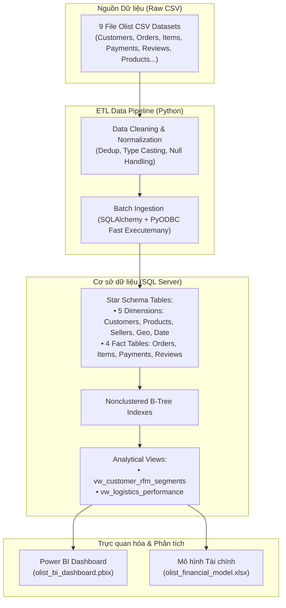

# Olist Brazilian E-Commerce Analytics Platform
### *End-to-End Data Engineering, Advanced Analytics & Business Intelligence*

---

## 1. Giới thiệu Dự án (Project Overview)

Dự án xây dựng giải pháp phân tích dữ liệu toàn diện (End-to-End Analytics Solution) dựa trên bộ dữ liệu thương mại điện tử công khai **Olist** (Brazil) gồm hơn 100.000 đơn hàng thực tế từ năm 2016 đến 2018. 

Hệ thống kết nối toàn bộ quy trình từ:
1. **Dữ liệu thô (Raw Data)**: Tập hợp các file CSV nhiều bảng quan hệ phức tạp.
2. **Kỹ thuật dữ liệu (Data Pipeline & ETL)**: Tự động hóa trích xuất, làm sạch, chuẩn hóa và nạp dữ liệu bằng Python (Pandas, SQLAlchemy, PyODBC).
3. **Kho dữ liệu quan hệ (Data Warehouse / Star Schema)**: Thiết kế lược đồ dữ liệu tối ưu trên Microsoft SQL Server với đầy đủ khóa ngoại, chỉ mục B-Tree và bảng chiều thời gian tự động (`dim_date`).
4. **Phân tích nâng cao (Advanced SQL Analytics)**:
   - **Mô hình RFM (Recency, Frequency, Monetary)**: Phân khúc khách hàng tự động để tối ưu chiến dịch Retention & Marketing.
   - **Phân tích hiệu suất chuỗi cung ứng & Logistics**: Đo lường SLA giao hàng, tỷ lệ trễ hạn (`delay_days`) và mối tương quan giữa thời gian giao vận với điểm hài lòng (`review_score`).
5. **Khai thác kinh doanh & Báo cáo (BI & Financial Modeling)**: Trực quan hóa dữ liệu trên **Power BI Dashboard** tương tác và phân tích doanh thu - chi phí trên **Excel Financial Model**.

---

## 2. Kiến trúc Hệ thống (System Architecture)



---

## 3. Cấu trúc Thư mục (Project Structure)

```text
olist-ecommerce-analytics-pipeline/
│
├── data/                                  
│   ├── olist_customers_dataset.csv
│   ├── olist_geolocation_dataset.csv
│   ├── olist_order_items_dataset.csv
│   ├── olist_order_payments_dataset.csv
│   ├── olist_order_reviews_dataset.csv
│   ├── olist_orders_dataset.csv
│   ├── olist_products_dataset.csv
│   ├── olist_sellers_dataset.csv
│   └── product_category_name_translation.csv
│
├── src/                                  
│   └── pipeline.py                        
│
├── sql/                                   
│   ├── schema.sql                         
│   ├── dim_date.sql                       
│   ├── vw_customer_rfm_segments.sql       
│   └── vw_logistics_performance.sql       
│
├── excel/                                 
│   └── olist_financial_model.xlsx
│
├── powerbi/                               
│   └── olist_bi_dashboard.pbix
│
├── .gitignore                             
├── requirements.txt                       
└── README.md                              
```

---

## 4. Mô hình Dữ liệu (Data Model & Schema)

Cơ sở dữ liệu được thiết kế theo chuẩn **Star Schema** tối ưu hóa cho truy vấn phân tích (OLAP):

### Bảng Chiều (Dimension Tables)
- **`dim_customers`**: Thông tin khách hàng (`customer_id`, mã định danh duy nhất `customer_unique_id`, thành phố, bang).
- **`dim_products`**: Thuộc tính sản phẩm (kích thước, cân nặng, danh mục).
- **`dim_sellers`**: Thông tin nhà bán hàng (vị trí địa lý, bang).
- **`dim_geolocation`**: Tọa độ địa lý vĩ độ/kinh độ theo mã bưu điện (`zip_code_prefix`).
- **`dim_category_translation`**: Bảng dịch tên danh mục sản phẩm từ tiếng Bồ Đào Nha sang tiếng Anh.
- **`dim_date`**: Chiều thời gian chi tiết (ngày, tháng, quý, năm, ngày trong tuần, ngày cuối tuần).

### Bảng Sự kiện (Fact Tables)
- **`fact_orders`**: Bảng fact trung tâm ghi nhận mã đơn hàng, trạng thái (`order_status`) và các mốc thời gian (mua, duyệt, xuất kho, giao hàng, hạn dự kiến).
- **`fact_order_items`**: Chi tiết sản phẩm trong đơn, số lượng, giá bán (`price`) và phí vận chuyển (`freight_value`).
- **`fact_order_payments`**: Phương thức thanh toán (thẻ tín dụng, boleto, voucher, thẻ ghi nợ), số kỳ trả góp và số tiền thanh toán.
- **`fact_order_reviews`**: Đánh giá đơn hàng (điểm số từ 1-5 sao, tiêu đề, nội dung nhận xét, thời gian phản hồi).

---

## 5. Các Hướng Phân tích Chuyên sâu (Advanced Analytics)

### 1. Phân khúc Khách hàng theo RFM (`vw_customer_rfm_segments.sql`)
- **Recency (R)**: Số ngày tính từ lần mua sắm gần nhất của khách hàng so với ngày chốt dữ liệu (`2018-09-03`).
- **Frequency (F)**: Tổng số đơn hàng thành công của khách hàng.
- **Monetary (M)**: Tổng giá trị chi tiêu mua hàng.
- Dùng hàm xếp hạng `NTILE(5)` chia khách hàng thành các phân khúc chiến lược:
  - **Champions**: Điểm R, F, M đều ở top đầu (mua gần đây, thường xuyên, chi tiêu khủng).
  - **Loyal Customers**: Khách hàng trung thành, tần suất mua cao.
  - **Recent Customers**: Khách hàng mới gia nhập, cần chăm sóc để gia tăng chuyển đổi.
  - **At Risk**: Khách hàng từng mua nhiều nhưng đã lâu không quay lại.
  - **Lost Customers**: Khách hàng đã rời bỏ (R thấp, F thấp).
  - **Potential / Standard**: Các nhóm khách hàng tiềm năng khác.

### 2. Đánh giá Vận hành & Logistics (`vw_logistics_performance.sql`)
- **Thời gian giao hàng thực tế**: `actual_delivery_days` (từ ngày đặt hàng đến ngày nhận hàng).
- **Thời gian dự kiến**: `estimated_delivery_days`.
- **Độ trễ vận chuyển**: `delay_days = actual_delivery - estimated_delivery`.
- **Trạng thái đơn hàng**: Phân loại `On Time`, `Delayed`, `Undelivered`.
- **Tương quan CSAT/Review**: Kết hợp với `avg_review_score` để đánh giá tác động trực tiếp của việc giao trễ hạn đến trải nghiệm khách hàng.

---

## 6. Hướng dẫn Cài đặt & Thực thi (Step-by-step Setup)

### Bước 1: Yêu cầu Tiền đề (Prerequisites)
1. **Python 3.10+** (khuyến nghị Python 3.11).
2. **Microsoft SQL Server** (bản Express, Developer hoặc Standard) đang hoạt động.
3. **ODBC Driver 17 for SQL Server** (hoặc ODBC Driver 18) đã cài trên Windows.
4. **Power BI Desktop** (để mở file `.pbix`).
5. **Microsoft Excel** (để mở file `.xlsx`).

### Bước 2: Cài đặt Môi trường Python
Mở Terminal hoặc PowerShell tại thư mục dự án và chạy:

```bash
# Tạo môi trường ảo 
python -m venv .venv

# Kích hoạt môi trường ảo:
# Trên Windows PowerShell:
.venv\Scripts\Activate.ps1
# Hoặc trên CMD:
.venv\Scripts\activate.bat

# Cài đặt các thư viện phụ thuộc
pip install -r requirements.txt
```

### Bước 3: Khởi tạo Cơ sở Dữ liệu & Bảng
Mở **SQL Server Management Studio (SSMS)** hoặc **Azure Data Studio**, kết nối đến SQL Server và thực thi theo thứ tự:
1. Chạy file `sql/schema.sql` để tạo database `olist_ecommerce`, các bảng Dimension, Fact và chỉ mục.
2. Chạy file `sql/dim_date.sql` để tạo bảng dữ liệu ngày tháng `dim_date`.

*(Lưu ý: Nếu SQL Server của bạn có cấu hình instance khác `localhost\SQLEXPRESS`, vui lòng điều chỉnh chuỗi kết nối trong `src/pipeline.py`).*

### Bước 4: Chạy Pipeline Nạp Dữ liệu (ETL)
Chạy script Python để đọc các file CSV trong thư mục `data/` và nạp vào SQL Server:

```bash
python src/pipeline.py
```
> Script tự động làm sạch trùng lặp, ép kiểu ngày tháng, xử lý giá trị khuyết thiếu và nạp dữ liệu theo lô (`chunksize=10,000`, `fast_executemany=True`) để tối ưu tốc độ.

### Bước 5: Tạo các Analytical Views trong SQL Server
Sau khi nạp dữ liệu thành công, thực thi tiếp 2 file sau trong SSMS:
1. `sql/vw_customer_rfm_segments.sql`
2. `sql/vw_logistics_performance.sql`

### Bước 6: Khám phá Dashboard & Báo cáo
- **Power BI**: Mở file `powerbi/olist_bi_dashboard.pbix` bằng Power BI Desktop. Cập nhật lại thông tin Server kết nối (nếu cần) để xem các báo cáo trực quan về Sales, Customers, Logistics.
- **Excel**: Mở file `excel/olist_financial_model.xlsx` để xem các bảng dự phóng tài chính, cơ cấu chi phí và doanh thu.

---

## 7. Công nghệ Sử dụng (Tech Stack)

| Lĩnh vực | Công nghệ 
| :--- | :--- |
| **Ngôn ngữ** | Python 3.11 
| **Xử lý Dữ liệu** | Pandas, NumPy 
| **Database Engine** | Microsoft SQL Server |
| **Database Driver** | SQLAlchemy, PyODBC |
| **Data Warehouse** | T-SQL |
| **Business Intelligence** | Power BI Desktop |
| **Financial Modeling** | Microsoft Excel |

---

## Tác giả (Author)
- Dự án Phân tích Dữ liệu Thương mại Điện tử Olist (Brazilian E-Commerce).
